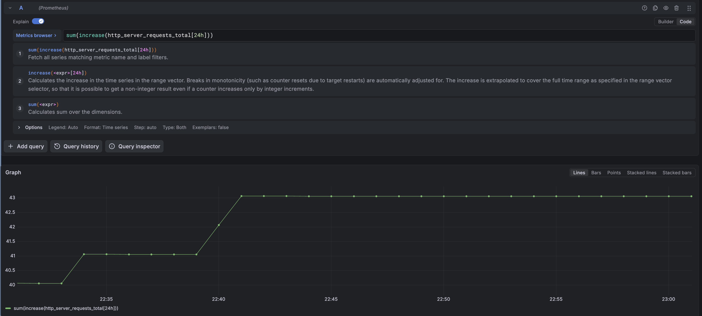
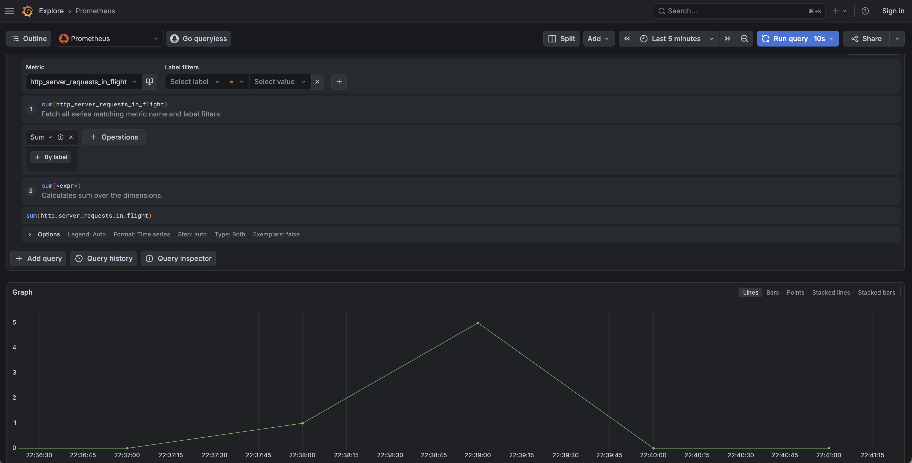
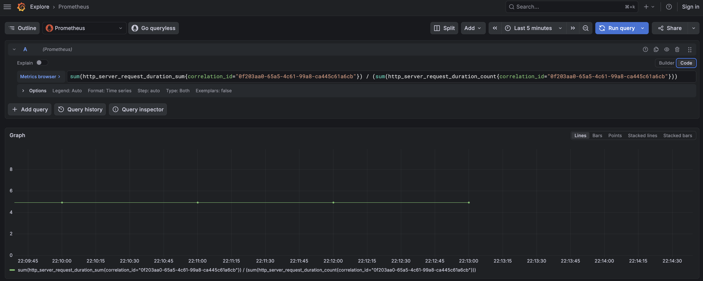

# Grafana (github.com/antonio-alexander/go-blog-observability)

I made a separate document because these things...although they're simple on the surface were a pain to figure out; so below, i'll show how I was able to capture certain things within grafana

## Http Server Total Request Count

In [service.go](./internal/service/service.go), I have a counter `http_server_requests_total` (see [counters.go](./internal/service/counters.go)), which increments by one each time a request begins. This is not very straight forward to graph because of how the data is organized in Prometheus. It's not organized like a counter that increments forever; it's like counters that increment for a period of time (a slice of time if you will). So to graph total requests (over a period of time); you can use the following promQL query: `sum(increase(http_server_requests_total[24h]))` and it should look like the following:

> You can also make this more specific (e.g., count a specific kind of request or requests) by adding label filters such as http route/method, correlation id, etc.

## Http Server Active Request Count

This was a little weird to get moving in the right direction; mostly because initially I wasn't using the right instrument (requires an up/down counter, not a gauge). I have an up/down counter `http_server_active_requests` (see [counters.go](./internal/service/counters.go)), which increments at the start of a request and decrements once a request finishes (even if it fails or panics); so generally the number should represent how many requests are in-flight or active at any given time. This metric provides you with an idea of functional load and when combined with other metrics, can point you in the direction to understanding what's going on. To graph active requests, you can use the following promQL query: `sum(http_server_requests_in_flight)` and it should look like the following:

## Http Server Average Latency

In my opinion, this is a relatively straight forward metric (although histograms are a bit odd because one metric creates three). You can calculate the average latency with this query: `rate(http_server_request_duration_sum{correlation_id="antonio-alexander"}[$__rate_interval]) / (rate(http_server_request_duration_count{correlation_id="antonio-alexander"}[$__rate_interval]))`. I put together the data for this query using the [sustained traffic scenario](./cmd/scenario/main.go) with a sleep duration of 5s:

<!-- TODO: aveage latency; I want to have a graph that shows a scenario where we're saturating the database connections and we can see a slight up-tick in the average latency; its very obvious from the traces, but not very obvious with average latency; we should be able to graph it along with in-flight requests and open database connections to drive it home; this may also be a great time to show P99 -->

## Http Server P## Latency

## Cache Hit/Miss Ratio with Sustained Traffic Exceeding Max DB Conns

I think this is obvious at a glance, but when it comes to metrics it can be hidden depending on the circumstances. When you attempt to access a resource that _can_ be cached, the first time you attempt to do so, the item most likely isn't in the cache, and then once the cache miss occurs, it's read from the database and then once it's been successfully read from the database, it'll be written to the cache and subequent reads will be successful.

This _read-through_ caching is pretty common, but comes with a downside: if consumers attempt to access data that isn't cached concurently; it's possible that you'll have more misses than expected. This is compounded because errors have far lower latency (and more opportunities to retry). So you'll likely be able to observe the following:

- an initial uptick of cache misses
- more cache misses than maximum concurrent requests
- an initial increase in average latency
